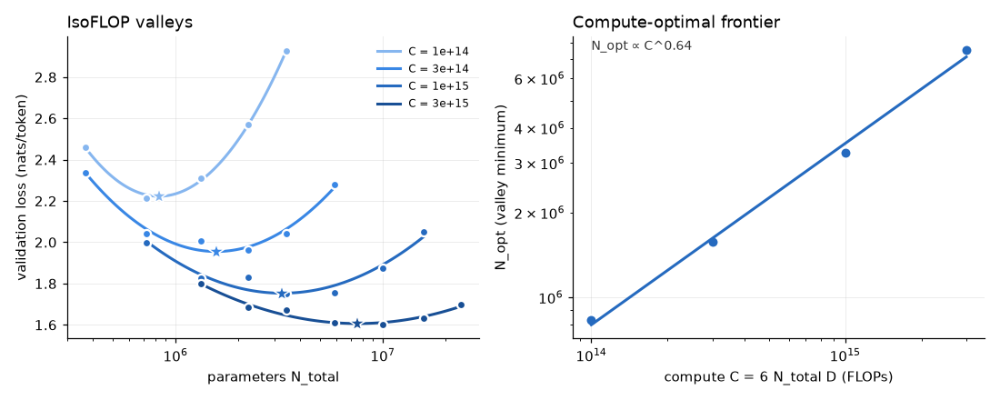

# Lab: Scaling Laws from First Principles

Code companion to the post
[Scaling Laws from First Principles](https://srini-anirudh.github.io/blogs/scaling-laws-from-first-principles/).

The post says that the shape of a compute-optimal model follows from two lines of algebra, and that you can measure
the coefficients with cheap runs. This lab does both. It counts the six FLOPs per parameter per token with PyTorch's
own FLOP counter. It solves the allocation problem in closed form and checks it by brute force. Then it trains a
family of small language models on TinyStories at four compute budgets on one H100, fits the IsoFLOP frontier and
the parametric loss law to those real runs, and tests a held-out prediction. The same runs also show what changes
when you count parameters Kaplan's way, and how an all-or-nothing metric can make smooth progress look sudden.

The models are C4's `TinyLLM` (imported from `c04-llm/`). The data and tokenizer come from C5 (`c05-pretraining/`).

## Layout

```
labs/scaling-laws-from-first-principles/
├── scalelab/
│   ├── flops.py        # 6ND per weight, head and attention terms, three published conventions, a measured count
│   ├── allocation.py   # loss law, closed-form N*/D*, brute-force check, lifetime cost, effective tokens, planner
│   ├── fit.py          # power law with floor, IsoFLOP parabola minimum, parametric Huber fit (batched, no SciPy)
│   ├── ladder.py       # ten model shapes (d64-L2 .. d512-L10) and their parameter counts; builds C4's TinyLLM
│   ├── data.py         # token windows on the GPU, epoch-wise reshuffling for repeated data
│   └── train.py        # one run: AdamW, warmup + cosine sized to the run, bf16, evaluation incl. k-token exact match
├── scripts/            # 00 to 08, listed below
├── results/            # real outputs; every file starts with its hardware and command
└── tests/
```

## Setup

From the repository root, after `pip install -e ".[dev]"`. The sweep needs the whole TinyStories train file
tokenized (552.6M tokens, about 1.1 GB on disk in `data_cache/`, which git ignores):

```bash
TOKENIZERS_PARALLELISM=true python labs/scaling-laws-from-first-principles/scripts/00_prepare_data.py   # ~4 min
```

## Run everything

```bash
L=labs/scaling-laws-from-first-principles
python -m pytest $L -m "not slow and not gpu and not network"    # 21 tests, about 30 s on CPU

# CPU, seconds each
python $L/scripts/01_six_flops.py          # where the 6 comes from, measured; Figure 3's conventions
python $L/scripts/02_allocation.py         # closed form vs brute force, invariant, drift of D/N, Gopher check
python $L/scripts/03_fit_synthetic.py      # do the fitting procedures recover a known law?

# GPU (one H100)
python $L/scripts/04_sweep.py --plan       # print the IsoFLOP grid
python $L/scripts/04_sweep.py --budgets 1e14,3e14,1e15,3e15   # 25 runs
python $L/scripts/06_repetition.py         # 7 runs, same compute, 1 to 64 epochs

# CPU, reading the GPU results
python $L/scripts/05_fit_sweep.py          # Approach 2, Approach 3, Kaplan accounting, held-out prediction
python $L/scripts/06_repetition.py --analyze
python $L/scripts/07_lifetime_planner.py   # inference-aware optimum, repetition discount, the planner
python $L/scripts/08_emergence.py          # per-token accuracy vs 16-token exact match on the sweep models
```

`04_sweep.py --smoke` runs two tiny models on CPU to check the code path. The sweep appends one JSON line per run to
`results/sweep.jsonl` and resumes from it, so it can be stopped and restarted.

## Which script covers which part of the post

| Post section | Script | What it shows |
|---|---|---|
| 2. Three numbers and one identity (Figures 2 and 3) | `01_six_flops.py` | 2 forward and 4 backward FLOPs per weight per token, counted by PyTorch; the three published conventions fan apart as width shrinks |
| 5. The allocation problem, solved (Figure 6) | `02_allocation.py` | Closed-form N*, D* against brute force; the invariant alpha T_N = beta T_D; constants set the intercept, not the slope |
| 1, 6, 13. Gopher check, valley shape, drift of tokens per parameter | `02_allocation.py` | Approximation 00, Aside 01, and the flat valley, from the published constants |
| 3 and 6. What a scaling law is; IsoFLOP (Figures 4 and 7) | `03_fit_synthetic.py` | On synthetic data with a known answer: the floor problem, the IsoFLOP procedure, the parametric fit |
| 6 and 10. Measure a frontier; predict a big run from small ones (Figures 7 and 11) | `04_sweep.py`, `05_fit_sweep.py` | A real 25-run IsoFLOP sweep, both fits, and a held-out prediction one budget out |
| 7. Why the two disagreed (Figure 8) | `05_fit_sweep.py` part 3 | The same runs refitted with non-embedding N: only the x-axis definition changes |
| 8. Train-optimal is not deploy-optimal (Figure 9) | `07_lifetime_planner.py` | Lifetime cost 6ND + 2NT: the optimum moves to smaller models, from the published constants and from this lab's fit |
| 9. Not every token is worth one (Figure 10) | `06_repetition.py`, `07_lifetime_planner.py` | Real runs with the same compute and fewer unique tokens, against the effective-token formula |
| 12. Do scaling laws ever break? (Figure 13) | `08_emergence.py` | Per-token accuracy against 16-token exact match on the 25 sweep models |
| 14. The planner (Figure 16) | `07_lifetime_planner.py` | The cluster to model-size calculator as a function (`allocation.plan`) |

Not built: sections 4 (Kaplan's three single-bottleneck experiments), 11 (loss to downstream accuracy), the broken
power law in section 12, and section 13's sparse scaling laws.

## Results

Every number names its hardware. Raw output is in `results/`, one file per script.

- GPU: NVIDIA H100 80GB HBM3, torch 2.15.0+cu132, CUDA 13.2, bf16 autocast. The GPU was held exclusively for each job.
- CPU: AMD EPYC 7R13, 8 threads, torch 2.15.0+cu132. These are arithmetic and fitting only.

Tests on AMD EPYC 7R13, 8 threads: 21 passed (`results/tests.txt`). There are no `network`, `slow` or `gpu` tests.

### The sweep (H100)

25 runs: C = 6 N_total D at 1e14, 3e14, 1e15 and 3e15 FLOPs, five to nine model sizes per budget, TinyStories,
4096-token BPE, sequence length 256, one seed. Training time was 14.2 minutes in total (`results/05_fit_sweep.txt`).
The full table of runs is in `results/sweep.jsonl`. The valley minimum is the vertex of a parabola through the runs at
one budget.

| C (FLOPs) | N_opt at the valley minimum | D_opt | D / N | L_min (nats per token) | Best run |
|---|---|---|---|---|---|
| 1e14 | 0.83 M | 20.0 M | 24.0 | 2.223 | d96-L3 |
| 3e14 | 1.58 M | 31.7 M | 20.2 | 1.955 | d160-L5 |
| 1e15 | 3.27 M | 50.9 M | 15.5 | 1.753 | d192-L6 |
| 3e15 | 7.57 M | 66.0 M | 8.7 | 1.607 | d320-L7 |



| Fit to the 25 runs | Result |
|---|---|
| Approach 2 (IsoFLOP minima), N_opt against C | N_opt ~ C^0.644, D_opt ~ C^0.356 |
| Approach 3 (parametric, N = N_total) | L = 1.313 + 1356 N^-0.565 + 4.71e6 D^-0.979; implied N* ~ C^0.634; mean abs error 0.017 nats in sample |
| Approach 3 with Kaplan's non-embedding N | L = 1.148 + 33.19 N_ne^-0.291 + 4.73e6 D^-0.980; implied N_ne* ~ C_ne^0.771 |
| Embedding share of N_total across the ladder | 8% to 71% |
| Held-out test: fit on C <= 1e15 (18 runs), predict all 7 runs at 3e15 | mean abs error 0.0167 nats; worst +0.033 and -0.042 |
| N_opt at 3e15: Approach 2 extrapolated / parametric / measured | 6.26 M / 7.12 M / 7.57 M |

How to read this. The exponents do not match Chinchilla's roughly 0.5. This lab's N_opt grows faster than the budget
to the half (0.64), and tokens per parameter at the optimum fall from 24 to 9 as the budget grows. The post's
section 7 says the answer depends on the experimental controls, and this sweep has the weak controls that section
lists: one seed, no per-scale tuning of learning rate or batch size, small models whose embedding table is up to 71% of
N_total, and only four budgets spanning 1.5 decades. We did not run the controlled version, so we cannot say which of
these causes the 0.64. The point of the lab is the procedure and its sensitivity, not the number. The Kaplan-style
refit changes the implied exponent from 0.63 to 0.77 with no change in the runs, which is the size of effect that
section 7 attributes to the definition of N.

The held-out prediction is the usable result. A law fitted on three budgets predicted the loss of seven models at a
budget 3x larger to within 0.017 nats on average, and placed the optimum within 6% to 17% of the measured N_opt.

### Counting FLOPs (CPU)

`01_six_flops.py`: for TinyLLM at four sizes, PyTorch's FLOP counter gives exactly 2.000 FLOPs per weight forward and
4.000 backward, 6.000 together, with the tied output head counted as a weight matmul. Attention is extra: its forward
is exactly 4LdS, and its backward counts 2.5x its forward because the fused kernel recomputes the scores. At d = 64
to 512 and sequence length 256 attention is 8% to 19% of the FLOPs. For a 32-layer model with a 100k vocabulary,
Kaplan's 6N_non-embedding is 0.81x the reference count at d = 4096, 0.35x at d = 512 and 0.21x at d = 256.

### The allocation, from published constants (CPU)

`02_allocation.py` uses Hoffmann et al.'s constants. The closed form agrees with a brute-force search to four
digits at every budget tried. The invariant alpha T_N / (beta T_D) is 1.000000 at every budget. Tripling A or
dividing B by three moves N* at 1e23 from 14.6 B to 85.9 B and leaves the fitted slope at 0.4516. At Gopher's budget
the constants recommend 32.2 B parameters at 93 tokens per parameter, as the post says. Anchoring on 20 tokens per
parameter at 5.8e23 and moving to 3.8e25 gives 30, against 41 measured by Meta. Under these constants, at three
budgets, a model four times too small costs slightly more loss than one four times too big (+0.0301 against +0.0285
at 1e23). The post's section 1 says going too large hurts faster than going too small. With these constants the two are within 6% of each other and the small side is slightly worse, so we could not confirm that claim.

### Fitting on synthetic data (CPU)

`03_fit_synthetic.py`, data drawn from the Hoffmann law with known parameters. A power-law fit with no floor, on
N = 1e7 to 10^9.5, extrapolates to a loss of 1.04 at N = 1e12 where the truth is 1.72; with the floor fitted it gives
1.67. Fixing the floor at 1.2, 1.5, 1.69 and 1.9 gives 1.42, 1.59, 1.72 and 1.90, so the extrapolation inherits the
assumed floor. The IsoFLOP procedure with 0.5% noise recovers the true exponent 0.452 as 0.452 and predicts the
1e23 optimum within 1.1%. The parametric fit recovers the exponent ratio (0.464 against 0.452) while E, A and B each
move by up to 15%.

### Repeated data (H100)

`06_repetition.py`: d192-L6 (3.44 M parameters), 48.4 M training tokens at C = 1e15 FLOPs in every run, drawn from the
first 48.4 M / R unique tokens. One seed. `results/06_repetition_analysis.txt`.

| Epochs | Unique tokens | Val loss | Change from 1 epoch |
|---|---|---|---|
| 1 | 48.4 M | 1.7607 | 0 |
| 2 | 24.2 M | 1.7613 | +0.03% |
| 4 | 12.1 M | 1.7804 | +1.1% |
| 8 | 6.05 M | 1.8651 | +5.9% |
| 16 | 3.03 M | 2.2104 | +25.5% |
| 32 | 1.51 M | 3.9174 | +122% |
| 64 | 0.76 M | 6.2424 | +255% |

Two to four epochs cost under 1.2%, in line with the post's "up to about four epochs is nearly free". After that the
loss rises quickly, and from 16 epochs the model is memorizing the small corpus. This is much worse than the
Muennighoff et al. effective-token form predicts: with R* = 15.4 and this lab's fitted law, the predicted loss at 16
epochs is 1.80 (we measured 2.21) and at 64 epochs 2.13 (we measured 6.24). The form was fitted to different model
sizes and a different data distribution, and we did not refit R* here, so this shows the qualitative shape (a flat
region, then a collapse) and not a test of the formula.

### Serving cost and the planner (CPU)

`07_lifetime_planner.py`. With Hoffmann's constants and a target loss of 1.90, the train-optimal model has 48.1 B
parameters. With 1e13 lifetime inference tokens the cheapest model is 29.6 B parameters, 0.61x the size, at 0.90x the
lifetime FLOPs of serving the train-optimal model. With 1e15 tokens it is 10 B parameters, at 0.27x the FLOPs. The
model size falls at every step of inference demand. The same calculation with the law fitted to this lab's sweep gives
the same direction (0.60x the size at 1e9 tokens, 0.45x at 1e12). The planner with the post's defaults (1,024 H100 for
720 hours at 42% MFU) gives C = 1.10e24 FLOPs, 43.2 B parameters and 4.26 T tokens at the Hoffmann constants.

### Scoring smooth progress all-or-nothing (H100 models, CPU analysis)

`08_emergence.py` scores the 25 sweep models on 1M validation tokens. Validation loss falls 1.33 nats from the worst
model to the best, next-token accuracy rises from 0.405 to 0.599 (1.5x), and 16-token exact match rises from 0.00028
to 0.00202 (7x). A 100-question test set would score 0.00 for every model. The range here is too narrow and the models
too weak to produce a sharp transition, so this shows the amplification and the resolution limit but not an emergent
jump.

## What was not measured

- The sweep has one seed, four budgets, and no per-scale tuning. Learning rate follows a fixed width rule, batch size
  a fixed budget rule, warmup is 5% of each run. The exponents it gives are not Chinchilla's and we did not isolate why.
- Models are 0.37 M to 24 M parameters on a simple children's-story corpus. Nothing here is at the scale of the papers
  the post cites (70 M to 16 B parameters, or 10^18 to 10^25 FLOPs), and no paper-scale number is reproduced.
- The controlled Kaplan-to-Chinchilla reconciliation (head FLOPs, warmup, per-scale tuning) was not run. We changed only
  the definition of N, in a refit of the same runs.
- No validation-loss-to-benchmark relation, no sparse or mixture-of-experts scaling, no broken power law.
- The effective-token constant R* was not refitted on our repetition runs.
- Throughput numbers in `sweep.jsonl` are per-run and small models are launch-bound; they are not benchmarks.
